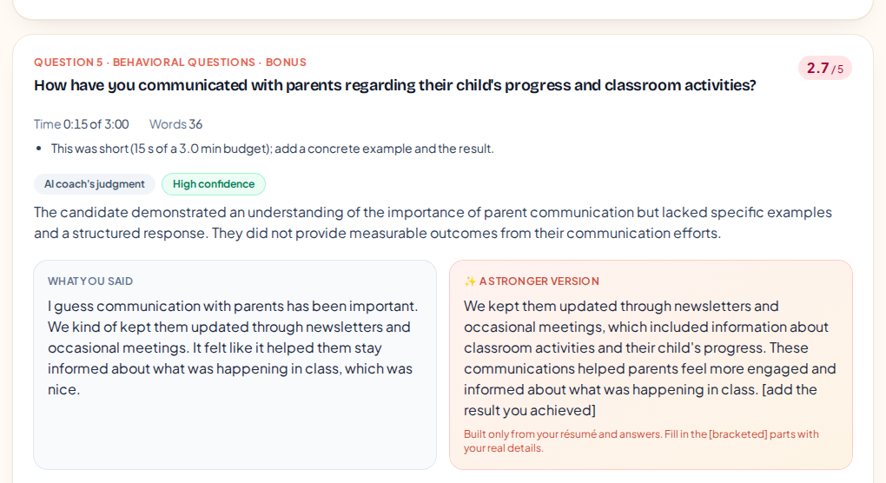
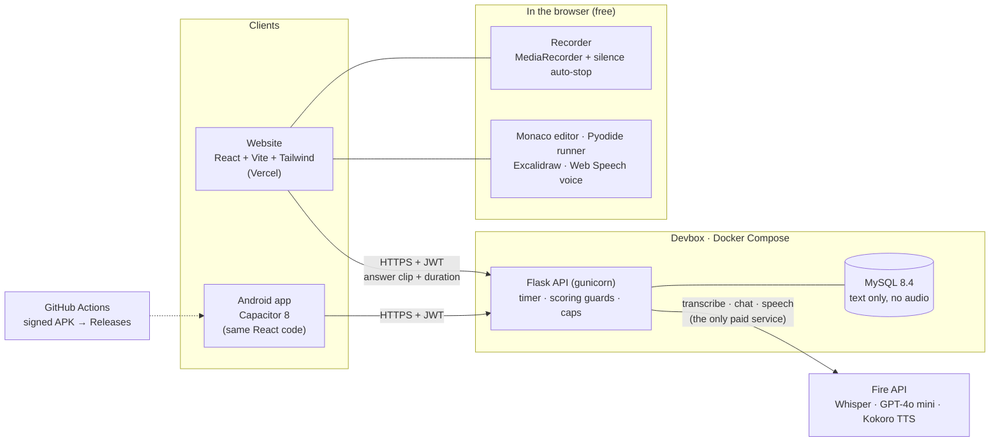
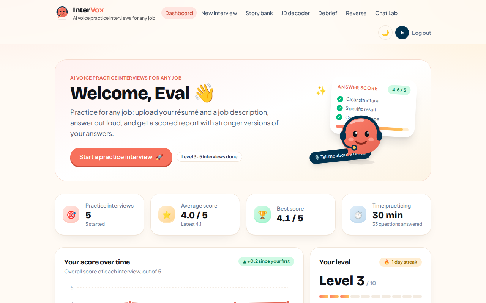

# InterVox — AI practice interviews for any job

Upload your résumé and a job description, answer the interviewer's questions out loud, and get a scored report that shows exactly what to fix, with a **stronger version of every answer built only from facts you gave**.

**[Try it: www.intervox.site](https://www.intervox.site)** · **[Android app (APK)](https://github.com/HibahNafees/InterVox/releases/latest/download/InterVox.apk)** · [Engineering report (PDF)](docs/InterVox-Project-Report.pdf)

*43-second demo, sped up: paste a résumé and job description, edit the plan, answer one question well and one vaguely, and get the report: 4.3/5 vs 2/5, with a stronger version of each answer. [Sharper MP4](docs/images/intervox-demo.mp4).*

## What it does

- **Any job, not just software.** The job description decides the interview: behavioral, technical, case, role-play, coding (in-browser editor with a Run button) or system design (whiteboard). New fields are a new mix of modules, not new code.
- **A real interview flow.** 10 to 60 minutes, a timer that moves on and wraps up like an interviewer would, follow-up questions, pressure mode, panel interviews, and a reverse mode where the AI is the candidate.
- **Feedback you can act on.** Each answer is scored against a rubric built from the job description, with what you did well, what was missing, pace and filler words, and a rewrite. The rewrite never invents experience: anything it doesn't know becomes a `[bracketed]` prompt for you to fill in.

*A weak answer scored 2.7/5. The rewrite keeps the candidate's own facts, drops the "I guess… kind of", and asks for the result instead of making one up.*

## Results: does the scoring tell good answers from bad?

An eval harness ([`evals/`](evals)) runs AI candidates with fixed personas through full 10-minute interviews on the real API, then compares their reports. Run on 2026-11-25: 7 job fields (backend engineering, sales, nursing, media production, business analysis, teaching, electrical trades) × 3 personas = 21 interviews, $0.43 of API spend.

| Candidate persona | Average score / 5 | Range | Verdicts |
|---|---|---|---|
| **Strong**: answers the question, one specific example, a measurable result | **3.98** | 3.76–4.13 | 4 hire, 3 lean hire |
| **Rambling**: knows the material, buries it in background and filler | **3.56** | 2.63–4.04 | 1 hire, 5 lean hire, 1 no hire |
| **Weak**: vague, "we" not "I", no numbers or outcomes | **2.37** | 2.11–2.63 | 7 no hire |

- **Strong beat weak in all 7 fields**, by 1.6 points on average; every weak candidate got "no hire" and no strong one did.
- **Strong beat rambling in all 7 fields**, but by less (0.42 on average). One limit, on purpose: a rambler who still gives every fact can score close to a strong answer (backend: 4.04 vs 4.07). InterVox never lowers scores for filler words or nervousness; those show up separately as delivery feedback.
- All 21 interviews finished, every persona stayed in character, and no interviewer line was disrespectful.

## Architecture

One turn: the browser records the answer and sends the clip with its length. Flask transcribes it, throws the audio away, saves the text, and asks the model for the next interviewer line, passing the time used and left in each section so the backend timer, not the model, decides when to move on. Reports are built after the interview, one question at a time in the background. Weighted scores, verdicts, pace and filler counts are computed in Python.

## Three engineering challenges

**1. Making a small, cheap model keep the rules.** Rules written only in the prompt ("don't invent experience", "don't praise", "judge relevance") were broken often enough to matter. So every rule that must hold is checked in code: each rewrite sentence has to cite the résumé or answer words it came from, otherwise it's dropped or turned into a placeholder; quotes the model claims the candidate said are matched against the transcript; off-topic and off-subject answers are caught by narrow checks and capped. Each fix came from a live check and a ticket, and each one has a test with the model mocked.

**2. A real product on a $1-a-month budget.** The only paid service is the Fire API (speech-to-text, chat, text-to-speech). Everything else is free: the browser does the voice, the code runner and the whiteboard; the site is on Vercel; the API runs on an existing server after the Oracle free tier refused the sign-up. A hard monthly ceiling pauses new sessions, and per-user daily caps are reserved in one conditional SQL update before any paid call, then given back if the call fails. A full mock interview with its report costs about 2 cents.

**3. Voice without real-time infrastructure.** Interviews are turn-based: no streaming servers, and no timestamps from Whisper. Answer length is measured in the browser, so pace is words ÷ duration, and since Whisper keeps "um" and "uh", filler counts work. The Android WebView turned out to have no speech synthesis, so the app asks the API for audio instead (capped per user per day), and Google blocks sign-in inside WebViews, so the app uses the native account picker. The signed APK is built by GitHub Actions, which refuses to publish it unless the signing certificate's fingerprint matches.

## Built with

React, Vite, Tailwind, Monaco, Excalidraw, Pyodide · Flask, SQLAlchemy, Pydantic, JWT, gunicorn · MySQL 8.4 · Docker Compose, nginx, Let's Encrypt · Vercel · Capacitor 8 · GitHub Actions · Fire API (Whisper Large v3 Turbo, GPT-4o mini, Kokoro)

Scores are practice feedback from an AI coach, not a hiring assessment. Audio is never stored. How it was built, ticket by ticket: [`docs/project-report.md`](docs/project-report.md). Running it locally: [`CLAUDE.md`](CLAUDE.md#running-locally).
